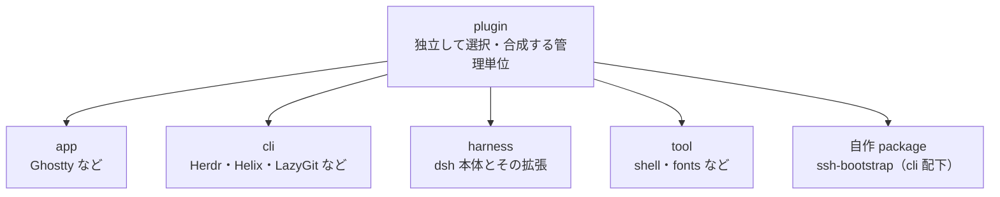
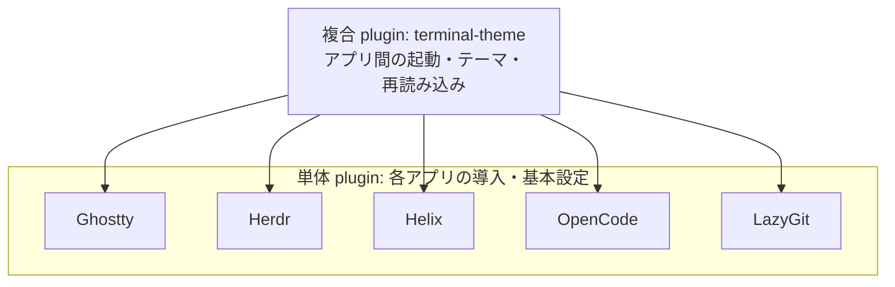

# dotfiles

## What this is / isn’t
私の開発環境
### 対象OS
- Mac OS
### 使用端末
- Mac Book Air M5 32gb
## What’s inside
### Editor
- vscode
- helix
### AI Coding
- codex
- claude code
- vibe cli
- dsh
- opencode
### Terminal
- Ghostty
- Herdr
### Tools
- lazygit
- fzf
- git-surgeon
- ripgrep
- yq-go
### develop environments
- devenv
- mise

## architecture

Homebrew・nixpkgs・npm/pnpm などの導入元に関係なく、app・cli・harness・tool・自作 package をすべて、独立して選択・合成できる plugin として管理します。自作 package も既存の分類内で plugin として公開します。

管理対象の例（矢印は分類）：



複数 plugin の組み合わせも一つの plugin です。以下の矢印は依存方向（複合 → 単体）を表します。



- [Ghostty](plugins/app/ghostty) 単体は [terminal-theme](plugins/tool/terminal-theme) を参照せず、Herdr を自動起動しません。Ghostty から Herdr を起動する設定は複合 plugin が持ちます。
- 組み替えるときは、単体 plugin を変えず、複合 plugin を置き換えます。Zellij を使う複合 plugin は未実装です。
- `harness` はクライアントではなくハーネス本体（dsh）とその拡張です。desktop・web・dsh-tui などのクライアントが共有する土台なので、特定クライアントの `cli` 配下には置かず、`harness` から対象クライアントを選びます。
- フォントのように一緒に使う組も一つのプラグインにできます。
- 新しい Python ツールはプラグインごとに devenv と uv で管理します。

## Installation

事前に次を用意してください。

- Homebrew。
- Mac App Store へのサインイン。
- [plugins/app/hanon-player/homebrew](plugins/app/hanon-player/homebrew) が参照するローカル tap `/Users/koki/Dev/mywork/eigo-no-hanon/homebrew-tap`。

このリポジトリを `~/.dotfiles` に取得し、対話ターミナルで実行します。Nix が未導入の場合は、スクリプトからインストールできます。

```sh
cd ~/.dotfiles
zsh scripts/install.sh
```
## Apply Changes

1. 適用前チェック
```sh
cd /Users/koki/.dotfiles
nix fmt
nix run home-manager -- build --flake .#koki
nix build .#darwinConfigurations.mac.system --out-link result-darwin
```
2. 変更を適用(mainブランチ)
```sh
sudo darwin-rebuild switch --flake /Users/koki/.dotfiles#mac
```
3. アカウントの設定のみ変更したい場合
```sh
zsh -c 'source scripts/lib/accounts.sh; parse_accounts accounts.csv'
```

`accounts.csv` は Git 管理外のまま用意してください。未作成・空・空行やコメントのみの場合、生成済みアカウント設定を削除します（SSH キーは残ります）。
